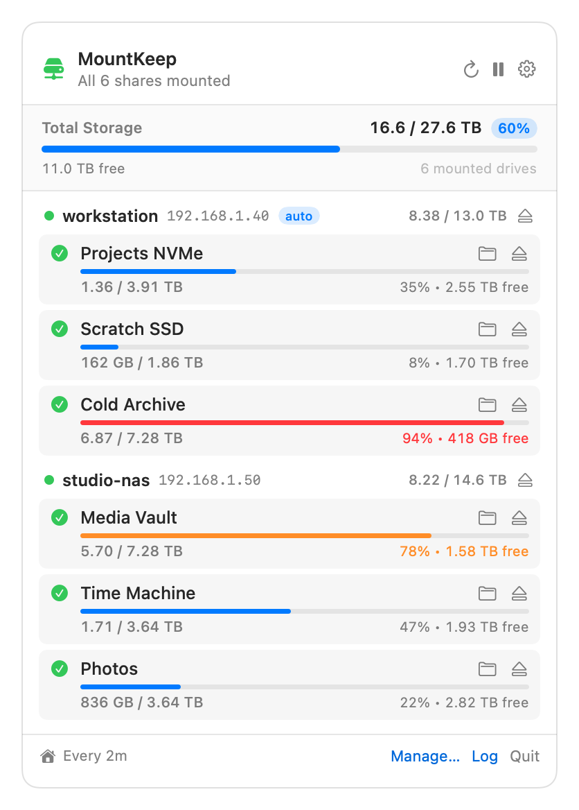
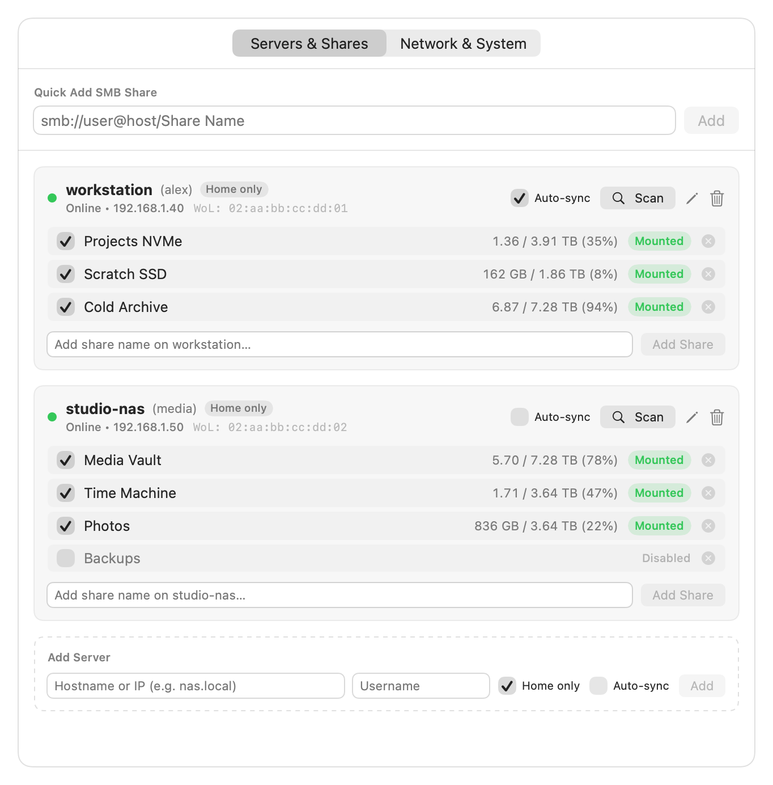
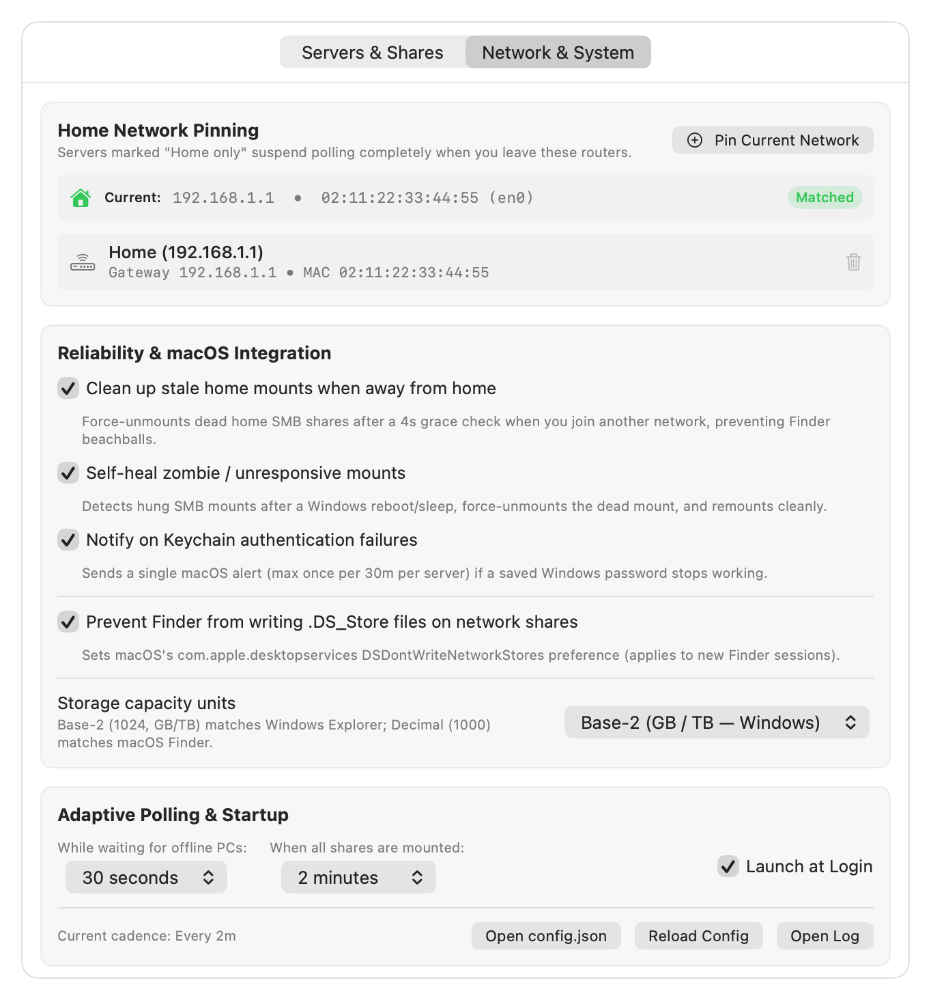

<p align="center">
  
</p>

<h1 align="center">MountKeep</h1>

<p align="center">
  A lightweight, zero-dependency macOS menu bar utility that keeps SMB network drives mounted reliably—silently, safely, and without bogging down your Mac away from home.
</p>

<p align="center">
  
  
  
  
</p>

---

## Screenshots

<p align="center">
  
</p>

<details>
<summary><strong>Settings & Preferences Screenshots</strong></summary>
<br />
<p align="center">
  
</p>
<p align="center">
  
</p>
</details>

---

## Why MountKeep?

macOS's built-in SMB mounting and Login Items have several long-standing paper cuts for anyone working with NAS boxes or Windows workstations over LAN:

- **Sleep/wake disconnects:** Opening your MacBook drops SMB mounts, forcing manual `⌘K` reconnections or breaking apps that expect `/Volumes/<Share>` to exist.
- **Pop-up storms & Finder windows:** Using Login Items or AppleScript `open smb://...` spawns a Finder window for every share and throws modal *"There was a problem connecting to the server"* dialogs whenever a host is asleep or you're away from home.
- **Away-from-home beachballs:** Closing your lid at home and reopening it at a coffee shop or office leaves dangling SMB mounts that freeze Finder and Open/Save dialogs while polling tools waste battery probing unreachable LAN hosts.
- **Zombie mounts after PC reboots:** If a Windows PC or NAS reboots mid-session, macOS can leave a dead mountpoint in `/Volumes` that fails on access or causes duplicate `Share-1` mount drift.

MountKeep solves these natively using Apple's `NetFS`, `Network`, `SystemConfiguration`, and `ServiceManagement` frameworks—no plaintext passwords, no third-party dependencies, and ~0% idle CPU.

---

## Common Use Cases

- **MacBook + Windows Workstation / Render Box:** Keep NVMe scratch disks, project archives, and shared libraries mounted at home; wake a sleeping PC over Wake-on-LAN directly from the menu bar; go completely dormant when you take your laptop out of the house.
- **Home Lab & NAS Storage Monitoring:** Track consumed/total/free space across multiple SMB drives at a glance—per drive, per server, and combined—with color-coded usage bars (`≥75%` amber, `≥90%` red).
- **Creative Media Workflows (Video, Photo, Audio):** Keep `/Volumes/...` paths stable across sleeps and reconnects, prevent Finder from scattering `.DS_Store` files across Windows shares, and bulk-eject a single server cleanly before rebooting it.

---

## Features

- **Silent Native Keychain Mounting (`NetFS`):** Uses `NetFSMountURLAsync` with `kNAUIOptionNoUI`, `kNetFSSoftMountKey`, and a configurable cancellation timeout. Reuses credentials saved in your macOS Login Keychain—never stores passwords and never opens Finder windows or auth popups.
- **Home Network Pinning (Zero Privacy Permissions):** Reads your router's gateway IP and hardware MAC address natively via `SCDynamicStore` (`ARPResolvedHardwareAddress` / `NetworkSignature`)—no Location Services prompt, works over Wi-Fi, Ethernet, and active VPNs. Off-network, MountKeep suspends its polling timer completely (**Dormant**: zero DNS lookups, zero port probes).
- **Stale-Mount Cleanup on Departure:** When switching to a non-home network while home mounts are still dangling, waits a 4-second grace confirmation (ignoring brief Wi-Fi roams) and force-unmounts dead shares so Finder never hangs.
- **Zombie / Hung Mount Self-Healing:** Timeout-guarded liveness probes detect dead SMB mounts after server reboots or sleeps, force-unmount the zombie, and remount cleanly.
- **Live Storage Telemetry:** Displays per-drive, per-server, and combined storage usage (`used / total`, `%`, free space) with slim severity bars. Supports **Base-2 (`GB` / `TB` — Windows Explorer)**, **IEC Binary (`GiB` / `TiB`)**, and **Decimal (`GB` / `TB` — macOS Finder)**.
- **Wake-on-LAN (WoL):** Sends standard 102-byte UDP magic packets over active subnet broadcast addresses (`getifaddrs`) when an offline PC has a MAC address configured, then accelerates follow-up mount probes as it boots.
- **Adaptive Polling & Actionable Alerts:** Uses instant macOS wake (`didWakeNotification`), network (`NWPathMonitor`), and volume unmount (`didUnmountNotification`) events; backs off to 2-minute checks when healthy, switches to 30s only when waiting for offline hosts, applies exponential failure backoff (`30s → 60s → 180s → 300s`), and notifies at most once per 30 minutes per server on Keychain auth failures.
- **Auto-Sync Share Discovery & Manual Respect:** Optional per-server share discovery (`smbutil view -N`) detects new non-hidden disk shares automatically while respecting shares you explicitly disabled. Manually ejecting a share inside MountKeep pauses auto-mount for that share until you remount it.
- **Native Login Item & `.DS_Store` Toggle:** Registers cleanly as `MountKeep.app` via `SMAppService.mainApp` (no legacy `LaunchAgent` plist clutter) and includes a toggle for macOS's `DSDontWriteNetworkStores` preference.

---

## Quick Start

### Requirements
- macOS 13 (Ventura) or newer
- Xcode Command Line Tools (`xcode-select --install`) to build from source

### Install
```bash
git clone https://github.com/musaandi/MountKeep.git
cd MountKeep
bash scripts/install.sh
```

`install.sh` compiles the release binary, generates `AppIcon.icns`, bundles and signs `~/Applications/MountKeep.app`, registers it as a native macOS Login Item, and launches it in the menu bar.

### First-Time Setup
1. **Save SMB credentials once in Keychain:** In Finder press `⌘K`, connect once to your server (e.g. `smb://user@server`), and check **"Remember this password in my keychain"**. MountKeep never stores passwords itself.
2. **Allow Local Network access:** Click **Allow** on the one-time macOS Local Network prompt so MountKeep can probe SMB port `445`.
3. **Add your servers & shares:** Click the MountKeep drive icon in the menu bar → **Manage…** (or paste any `smb://user@host/Share Name` URL into **Quick Add SMB Share**).
4. **Pin your home network (optional, recommended for laptops):** Open **Manage… → Network & System** and click **Pin Current Network**.

---

## CLI Usage

The app bundle executable also supports quick terminal inspection and scripting:

```bash
# Live network status, storage totals, and per-share mount state
~/Applications/MountKeep.app/Contents/MacOS/MountKeep --status

# Run a single immediate mount pass for all eligible enabled shares
~/Applications/MountKeep.app/Contents/MacOS/MountKeep --mount-now
```

Or via `make` from the repository directory:
```bash
make test        # Run unit test suite
make install     # Build release .app, sign, and launch
make status      # Print live status & storage totals
make mount-now   # Trigger one-shot mount pass
make logs        # Tail ~/Library/Logs/MountKeep.log
make uninstall   # Unregister Login Item and remove ~/Applications/MountKeep.app
```

---

## Configuration

Settings are stored as human-editable JSON at `~/Library/Application Support/MountKeep/config.json` (zero passwords are ever stored here) and logs rotate automatically at `~/Library/Logs/MountKeep.log`.

<details>
<summary><strong>Example <code>config.json</code></strong></summary>

```json
{
  "cleanupStaleMountsOnAway": true,
  "healZombieMounts": true,
  "homeNetworks": [
    {
      "gatewayIP": "192.168.1.1",
      "gatewayMAC": "02:11:22:33:44:55",
      "id": "00000000-0000-0000-0000-000000000001",
      "name": "Home (192.168.1.1)"
    }
  ],
  "idlePollIntervalSeconds": 120,
  "mountTimeoutSeconds": 15,
  "notifyOnAuthFailure": true,
  "paused": false,
  "pollIntervalSeconds": 30,
  "servers": [
    {
      "autoSyncAllShares": true,
      "host": "workstation",
      "id": "00000000-0000-0000-0000-000000000010",
      "macAddress": "02:aa:bb:cc:dd:01",
      "requireHomeNetwork": true,
      "shares": [
        {
          "enabled": true,
          "id": "00000000-0000-0000-0000-000000000101",
          "name": "Projects NVMe"
        }
      ],
      "username": "alex"
    }
  ],
  "storageUnitStyle": "binaryHuman",
  "version": 2
}
```

</details>

---

## Architecture

| Component | Purpose |
| --- | --- |
| [`NetFSMounter`](Sources/MountKeepCore/Services/NetFSMounter.swift) | Native `NetFSMountURLAsync` silent Keychain mounting, timeout cancellation, `NSWorkspace` / `diskutil` unmounting, liveness health probes, and `smbutil view -N` share discovery |
| [`MountInspector`](Sources/MountKeepCore/Services/MountInspector.swift) | Non-blocking POSIX `getfsstat()` SMB mount snapshot, host/IP normalization, RFC 3986 SMB URL builder, and timeout-guarded live capacity refresh |
| [`HomeNetworkDetector`](Sources/MountKeepCore/Services/HomeNetworkDetector.swift) | Permission-free gateway IP + router MAC detection via `SCDynamicStore` per-service IPv4 state |
| [`NetworkReachability`](Sources/MountKeepCore/Services/NetworkReachability.swift) | Non-blocking BSD socket `:445` TCP probe + `NWPathMonitor` network transition observer |
| [`SystemUtilities`](Sources/MountKeepCore/Services/SystemUtilities.swift) | Wake-on-LAN UDP magic packet broadcaster (`getifaddrs`), throttled `UNUserNotificationCenter` auth notifier, and Finder `DSDontWriteNetworkStores` preference |
| [`LaunchAgentManager`](Sources/MountKeepCore/Services/LaunchAgentManager.swift) | Native `SMAppService.mainApp` Login Item registration with automatic legacy plist cleanup |
| [`RemotePower`](Sources/MountKeepCore/Services/RemotePower.swift) | Zero-dependency SSH remote power-off using forced-command Ed25519 shutdown keys and pre-unmount safety |
| [`UpdateChecker`](Sources/MountKeepCore/Services/UpdateChecker.swift) | GitHub Releases API update checks and bundled `CHANGELOG.md` What's New parser |
| [`MountManager`](Sources/MountKeepCore/Services/MountManager.swift) | `@MainActor` orchestrator tying wake/network/unmount events, adaptive polling, backoff, stale cleanup, and zombie healing together |

---

## Remote Shut Down (Optional, via SSH)

In addition to Wake-on-LAN (`Wake` when offline), MountKeep can safely shut down an online Windows PC (`Off` button with confirmation):

1. Open **Settings → Servers & Shares**, click the pencil (**Edit**) icon on a server, and click **Setup Guide…**.
2. Click **Generate Shutdown Key** to create a dedicated Ed25519 key at `~/.ssh/mountkeep_power`.
3. Click **Copy PowerShell** and run the script once in **PowerShell as Administrator** on the Windows PC. It enables Windows' built-in OpenSSH Server and installs the key in `C:\ProgramData\ssh\administrators_authorized_keys` prefixed with:
   ```text
   command="shutdown /s /t 5",no-port-forwarding,no-X11-forwarding,no-agent-forwarding,no-pty
   ```
   Because of the forced-command restriction, the key **cannot open a shell or run any other command**—it can only trigger a 5-second graceful shutdown.
4. Check **Enable Remote Shut Down (SSH)** and click **Save**. When triggered, MountKeep cleanly unmounts all mounted shares on that server first and cancels shutdown automatically if any files are busy.

---

## License

[MIT](LICENSE)
